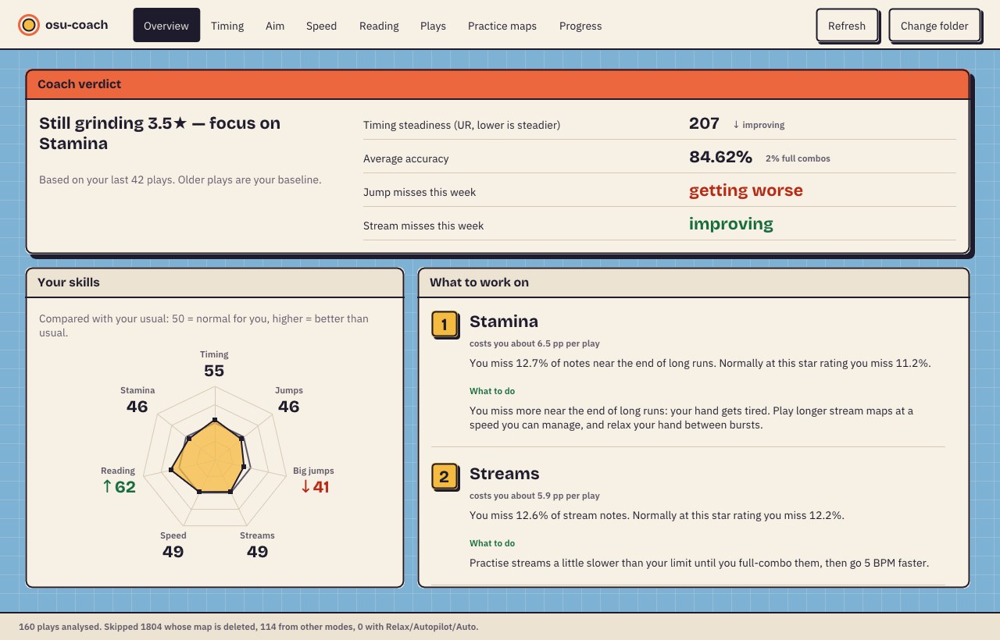
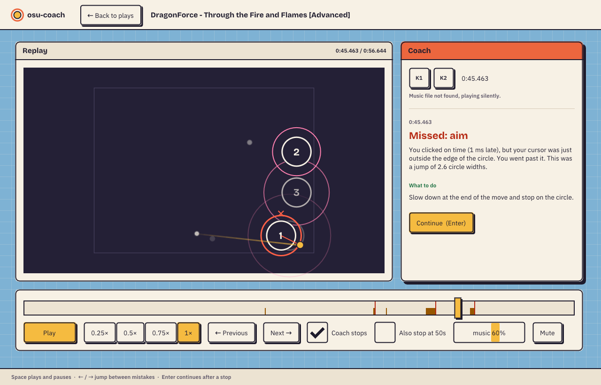

# osu-coach

A personal coach for **osu! stable** (standard mode). It reads the replays and maps already on your PC, finds what costs you notes and pp, and tells you in plain English what to practise next. It can also **play your replay back with the music and stop at every mistake to explain what went wrong.**



It's a single ~1.5 MB Windows exe: no installer, no account, no API key. It only reads files on your PC.

## Watch your replays with the coach

Pick a play on the **Plays** tab and press **Watch replay with the coach**. You'll see:

- the circles, sliders, spinners and approach circles, timed and sized with your mods (HR is shown flipped, the way you played it)
- your cursor with a short trail, a dot wherever you clicked (one colour per key), and K1/K2 lighting up while held
- a timeline you can drag, with a red mark for every miss and an amber mark for every 100 or 50
- the song playing in sync, at 0.25×, 0.5×, 0.75× or 1× (slower speeds lower the pitch)

The coach **stops at each mistake**. It draws a red ring on the note, plus a line from where you clicked to where you should have, and explains what happened, for example:

> **Missed: aim.** You clicked on time (33 ms early), but your cursor was just outside the edge of the circle. You stopped short of it. This happened in the middle of a stream.
> **What to do:** Move all the way to the centre of the circle; don't slow down before you arrive.

Space plays and pauses, the arrow keys jump between mistakes, and Enter continues. Stops can be switched off, or extended to 50s.



## What it tells you

| Tab | In plain words |
|---|---|
| **Overview** | the coach's verdict ("Ready to push to 4.5★" or "Still grinding 4.0★"), your skills compared with your usual, and the three things costing you the most pp, each with what to do |
| **Timing** | how steady your timing is (UR, lower is steadier), whether you click early or late, and how often you're within 15/30/50 ms of perfect |
| **Aim** | how often you miss close notes, short moves, jumps and big jumps (in circle widths), and whether you stop short of the circle or go past it |
| **Speed** | finger lock (still holding the last key when you press the next), switching fingers, speeding up in long streams, your comfortable stream BPM |
| **Reading** | misses on the first note after a pause, and on circles that appear slowly vs quickly (AR) |
| **Plays** | every play, and for each one every miss with its time and cause |
| **Practice maps** | five maps from your Songs folder that train your weakest skill |
| **Progress** | day-by-day timing, jump misses and stream misses, kept in `history.json` so it survives deleting maps |

## Use

1. Download `osu-coach.exe` from [Releases](../../releases) and run it.
2. It finds osu! by itself (file association, or `%LOCALAPPDATA%\osu!`). If it can't, it asks for the folder that has `osu!.db` in it.
3. Play some maps, then press **Refresh**.

Only plays whose map is still installed can be analysed. osu! keeps a replay of every local play in `Data\r`.

Command line:

```
osu-coach.exe --dump plays.jsonl [--osu PATH]   per-play stats as JSON lines, no window
osu-coach.exe --screenshot DIR                  save every tab and the viewer as BMPs, then exit
osu-coach.exe --synctest                        check that the music plays at the right speed
```

## Build

Needs Visual Studio 2022 (or the Build Tools) with the C++ workload.

```
build.bat          builds osu-coach.exe
build.bat test     builds and runs the unit tests
```

`tools/check.py` compares `--dump` output with the reference Python analyzer (`tools/ref_analyze.py`). On 466 real replays, simulated misses and UR match it exactly. Circle misses come within 2 of the game's own count on 97% of plays (stable doesn't count a missed slider head as a miss).

## How it works

- `src/parse.cpp` reads `.osr` (LZMA replay frames), `.osu` (sections, slider curves: straight, arc, bezier, catmull) and `osu!.db` (star ratings per mod).
- `src/analyze.cpp` re-runs hit detection on the replay: hit windows `80−6·OD / 140−8·OD / 200−10·OD`, radius `54.4−4.48·CS`, with HR/EZ/DT/HT applied. For every note it records the timing error, key, hold time, aim distance and why it was missed.
- `src/coach.cpp` builds the skill comparison, the pp estimate, the weaknesses and plain-English explanations, the practice-map scores and the history.
- `src/viewer.cpp`, `src/playback.cpp` and `src/audio.cpp` run the replay viewer. The music position drives the replay clock, so the two can't drift apart.
- `src/scan.cpp` analyses replays on all CPU cores, about 1 s for 450 plays. `src/main.cpp` and `src/gui.cpp` are the Dear ImGui / DirectX 11 window, which sleeps when idle.

Third-party code, all in `third_party/`:
- [Dear ImGui](https://github.com/ocornut/imgui) (MIT)
- the [LZMA SDK](https://www.7-zip.org/sdk.html) decoder (public domain)
- [miniaudio](https://github.com/mackron/miniaudio) and [stb_vorbis](https://github.com/nothings/stb) (public domain / MIT)
- the fonts [IBM Plex Sans](https://github.com/IBM/plex) and [Bricolage Grotesque](https://github.com/ateliertriay/bricolage) (SIL Open Font License)

## License

MIT
